# Employee Management System with Maintainability Enhancement and TQM-Based Quality Analysis

[](https://www.python.org/)
[](https://github.com/TomSchimansky/CustomTkinter)
[-emerald.svg)](https://www.sqlite.org/)
[-success.svg)](https://docs.pytest.org/)
[](#the-five-mandatory-q11-maintainability-features)
[](#student--academic-project-details)

---

## Student & Academic Project Details

- **Student Name:** Prabhat Singh Bhainsora  
- **Registration / Roll Number:** 2410302046  
- **Branch & Section:** Computer Science & Engineering (CSE) — Section B  
- **Course Code:** BBAT104  
- **Course Name:** Fundamentals of Total Quality Management (TQM)  
- **Academic Session:** 2026–27  
- **Assigned Baseline Software System:** Employee Management System  
- **Assigned Quality Goal:** **Q11 — Improve Maintainability**  
- **Project Title:** *“Employee Management System with Maintainability Enhancement and TQM-Based Quality Analysis”*  
- **Target GitHub Repository:** `BBAT104_TQM_2410302046`

---

## 1. Project Objectives

1. **Enterprise Employee Operations:** Deliver a standalone, local desktop application providing full lifecycle management of organizational employee records (CRUD, searching, multi-criteria filtering, pagination, and multi-format reporting).
2. **Operational TQM Quality Governance:** Operationalize core Total Quality Management (TQM) principles—Customer Focus, Continuous Improvement (Kaizen), Process-Centric Approach, Fact-Based Decision Making, and Error Prevention (Poka-Yoke).
3. **Q11 Maintainability Enhancement:** Implement five mandatory architectural features specifically designed to improve software maintainability, reduce Mean Time to Repair (MTTR), prevent architectural erosion, and ensure software longevity.
4. **Statistical Quality Control (SQC) Tools:** Integrate interactive Pareto Analysis (80/20 rule), Ishikawa (Fishbone) Cause-and-Effect Modeling, empirical Defect Checksheets, Failure Mode and Effects Analysis (FMEA), SIPOC Process Maps, Critical to Quality (CTQ) Trees, and Deming Plan-Do-Check-Act (PDCA) Continuous Improvement tracking.

---

## 2. Key Features

### 2.1 Core Employee Management Module
- **Create:** Modal registration form with real-time Poka-Yoke format checking and duplicate code/email prevention.
- **Read:** Sortable multi-column table, status indicators, and responsive pagination ($10, 20, 50$ records per page).
- **Update:** Pre-populated edit modal with data validation and instant table re-rendering.
- **Delete:** Non-destructive deletion workflow requiring explicit user confirmation.
- **Search & Filter:** Instant multi-field keyword search (code, name, email, designation) combined with department and status dropdown filters.

### 2.2 Total Quality Management & SQC Suite
- **TQM Quality Analysis Center:** Dedicated analytical hub detailing the 5 TQM principles, 5 Q11 maintainability features, empirical defect checksheets, SIPOC lifecycle, and CTQ trees.
- **FMEA Risk Register:** Automated Risk Priority Number ($RPN = \text{Severity} \times \text{Occurrence} \times \text{Detection}$) calculation with high-risk threshold warnings ($RPN \ge 120$).
- **Defect Checksheet & Tracker:** Defect logging, severity categorization, root cause assignment, and checksheet aggregation without double-counting.
- **Interactive Pareto Chart:** Embedded Matplotlib visualization ordering defect frequencies descending with a dual-axis cumulative percentage line and PNG export.
- **Ishikawa / Fishbone Diagram:** Cause-and-effect modeling across People, Process, Software Code, and Infrastructure, distinguishing investigated from suspected causes.
- **Deming PDCA Tracker:** Kaizen continuous improvement tracker enforcing verifiable baseline and post-action measurements across Plan, Do, Check, and Act phases.

### 2.3 Reporting & Data Export
- Multi-format report export to `reports/`:
  - **PDF Documents:** Structured executive tables with dynamic column wrapping via ReportLab.
  - **Excel Spreadsheets (`.xlsx`):** Multi-tab workbooks via OpenPyXL and Pandas.
  - **CSV Files (`.csv`):** Standard comma-separated data files for external auditing.
  - **High-Resolution Charts (`.png`):** 200 DPI vector-accurate PNG exports of Pareto, Fishbone, SIPOC, and CTQ diagrams.

---

## 3. The Five Mandatory Q11 Maintainability Features

The assigned quality goal is **Q11 — Improve Maintainability**. The application implements five mandatory maintainability features:

### Feature 1: Modular Architecture
The system is partitioned into independent single-responsibility packages:
- `app/`: Application container, dependency injection, and startup orchestration.
- `database/`: Connection pooling, WAL mode pragmas, schema DDL, and migrations.
- `models/`: Type-annotated dataclass entities (`Employee`, `Defect`, `FMEARecord`, `PDCARecord`).
- `services/`: Domain business logic, validation rules, reporting, and backup management.
- `analytics/`: Mathematical and chart-generation routines for SQC tools.
- `ui/`: CustomTkinter presentation layer, views, and reusable components.
- `tests/`: Automated unit and integration test suite.
*Impact on Maintainability:* High cohesion and loose coupling; UI changes cannot corrupt database queries, and database alterations do not require GUI refactoring.

### Feature 2: External Configuration Files
All operational parameters are stored externally in `config.json` (application version, database path, log level, default theme, UI scaling, records per page).
*Self-Healing Recovery:* If `config.json` is missing or corrupted, `ConfigurationService` intercepts the error, emits a descriptive warning, restores safe factory defaults from `config.example.json`, and re-saves the file.

### Feature 3: Dynamic System Settings Screen
A live administrative settings interface allows operators to adjust:
- Themes (Light, Dark, System)
- Interface Scaling ($100\%, 110\%, 125\%$)
- Records per page pagination limit ($5, 10, 20, 50$)
- Logging level (`DEBUG`, `INFO`, `WARNING`, `ERROR`)
- Confirmation modal preferences
*Impact on Maintainability:* User preferences persist in `config.json` across restarts and take immediate effect without code recompilation.

### Feature 4: Controlled Activity Logging & In-App Log Viewer
The application uses Python's standard `logging` library configured with a `RotatingFileHandler`:
- **Size Cap:** Maximum 1 MB per log file.
- **Backup Retention:** Exactly 5 rolling backup files (`application.log.1`, `application.log.2`, etc.) to eliminate unbounded disk growth.
- **In-App Log Viewer:** View events filtered by date, log level, and keyword search.
- **Security:** Passwords and sensitive secrets are never logged.

### Feature 5: Code Documentation & Maintainability Guides
Every class, module, and service is documented with clear docstrings, business rule explanations, and RPN calculation formulas. The `docs/` directory provides exhaustive architecture flowcharts, SRS, user manuals, FMEA matrices, SIPOC maps, CTQ trees, SQC guides, PDCA logs, and viva voce preparation material.

---

## 4. Technology Stack

- **Application Logic:** Python 3.10 / 3.11 / 3.12 (Standard Library + Type Hinting)
- **Desktop Graphical Interface:** [CustomTkinter](https://github.com/TomSchimansky/CustomTkinter) (Modern Tkinter wrapper with dark/light mode support)
- **Database Engine:** SQLite 3 (Configured with Write-Ahead Logging `WAL` mode and foreign keys)
- **Data Manipulation & Tables:** [Pandas](https://pandas.pydata.org/)
- **SQC Charts & Diagrams:** [Matplotlib](https://matplotlib.org/) (Embedded via `FigureCanvasTkAgg`)
- **PDF Report Generation:** [ReportLab](https://www.reportlab.com/)
- **Excel Export Engine:** [OpenPyXL](https://openpyxl.readthedocs.io/)
- **Automated Testing Suite:** [Pytest](https://pytest.org/)

---

## 5. Architectural Overview

```mermaid
graph TD
    subgraph UI_Tier ["Presentation Tier (CustomTkinter GUI)"]
        UI_Main["MainWindow (Sidebar & Router)"]
        UI_Dash["DashboardView"]
        UI_Emp["EmployeeView & FormDialog"]
        UI_TQM["TQMView (Principles & Checksheet)"]
        UI_FMEA["FMEAView (RPN Register)"]
        UI_SQC["SQCChartsView (Matplotlib)"]
        UI_PDCA["PDCAView (Kaizen Cycles)"]
        UI_Log["LogsView (Activity Logs)"]
        UI_Set["SettingsView (Theme & Backup)"]
    end

    subgraph Service_Tier ["Service & Business Logic Tier"]
        S_Emp["EmployeeService"]
        S_TQM["TQMService"]
        S_Val["ValidationService (Poka-Yoke)"]
        S_Bak["BackupService (Snapshot & Restore)"]
        S_Rep["ReportService (PDF/Excel/CSV)"]
        S_Cfg["ConfigurationService (Self-Healing)"]
        S_Log["LoggingService (RotatingFileHandler)"]
    end

    subgraph Analytics_Tier ["SQC Analytics Tier"]
        A_Pareto["ParetoAnalyzer (80/20 Dual-Axis)"]
        A_Fish["FishboneGenerator (4 Categories)"]
        A_SIPOC["SIPOCMapper"]
        A_CTQ["CTQTree"]
    end

    subgraph Storage_Tier ["Persistence & Configuration Tier"]
        DB[("SQLite3 Database: data/employee_tqm.db (WAL Mode)")]
        CFG[("Config: config.json")]
        LOG[("Logs: logs/application.log")]
        BAK[("Snapshots: backups/*.db")]
        REP[("Reports: reports/*.pdf, *.xlsx, *.csv")]
    end

    UI_Main --> UI_Dash & UI_Emp & UI_TQM & UI_FMEA & UI_SQC & UI_PDCA & UI_Log & UI_Set
    UI_Emp & UI_Dash --> S_Emp
    UI_TQM & UI_FMEA & UI_SQC & UI_PDCA --> S_TQM
    S_Emp & S_TQM --> S_Val
    UI_SQC --> A_Pareto & A_Fish & A_SIPOC & A_CTQ
    S_Emp & S_TQM --> DB
    S_Cfg --> CFG
    S_Log --> LOG
    S_Bak --> BAK
    S_Rep --> REP
```



---

## 6. Directory Structure

```text
employee_management_tqm/
│
├── main.py                     # Primary desktop application entry point
├── requirements.txt            # Python package dependencies
├── README.md                   # Comprehensive project documentation
├── .gitignore                  # Git ignore rules (protects databases and logs)
├── config.json                 # Active external configuration file (Q11 Feature 2)
├── config.example.json         # Factory default fallback configuration
├── run.bat                     # Windows double-click application launcher
├── run_tests.bat               # Windows double-click pytest test runner
│
├── app/                        # Application container & dependency injection
│   ├── __init__.py
│   └── application.py          # Startup lifecycle and service wiring
│
├── database/                   # Persistence tier
│   ├── __init__.py
│   ├── connection.py           # SQLite3 connection manager (WAL mode & pragmas)
│   ├── schema.py               # DDL tables, indices, and sample demonstration data
│   └── migrations/             # Schema migration tracking
│       └── __init__.py
│
├── models/                     # Type-annotated domain dataclass entities
│   ├── __init__.py
│   ├── employee.py             # Employee entity
│   ├── defect.py               # Defect log entity
│   ├── fmea.py                 # FMEA risk item entity
│   └── pdca.py                 # PDCA continuous improvement cycle entity
│
├── services/                   # Business logic & domain services
│   ├── __init__.py
│   ├── employee_service.py     # Employee CRUD, searching, and filtering
│   ├── tqm_service.py          # Defect checksheet, FMEA RPN, PDCA, and Fishbone
│   ├── validation_service.py   # Poka-Yoke input validation rules (Regex/bounds)
│   ├── configuration_service.py# Self-healing config manager (Q11 Feature 2)
│   ├── logging_service.py      # Centralized RotatingFileHandler logging (Q11 Feature 4)
│   ├── backup_service.py       # Online SQLite backup and non-destructive restore
│   └── report_service.py       # Multi-format report exporter (CSV, Excel, PDF)
│
├── analytics/                  # Statistical Quality Control (SQC) algorithms
│   ├── __init__.py
│   ├── pareto.py               # Pareto 80/20 frequency and cumulative math
│   ├── fishbone.py             # Ishikawa cause-and-effect diagram generator
│   ├── sipoc.py                # SIPOC process flowchart mapper
│   └── ctq.py                  # Critical to Quality tree generator
│
├── ui/                         # Presentation tier (CustomTkinter GUI)
│   ├── __init__.py
│   ├── main_window.py          # Main application frame & sidebar router
│   ├── dashboard.py            # Executive dashboard with KPI cards and charts
│   ├── employee_view.py        # Sortable employee table with pagination & search
│   ├── employee_form.py        # Modal employee registration/edit form
│   ├── tqm_view.py             # TQM Quality Analysis Center (Principles, Checksheet)
│   ├── defect_view.py          # Defect log tracking and management
│   ├── fmea_view.py            # FMEA risk register with RPN color coding
│   ├── sqc_view.py             # SQC chart viewer with embedded Matplotlib canvas
│   ├── pdca_view.py            # Deming PDCA improvement tracker interface
│   ├── reports_view.py         # Report generation and export hub
│   ├── settings_view.py        # System settings & backup/restore manager (Q11 Feature 3)
│   ├── logs_view.py            # In-app log viewer with level filtering
│   ├── help_view.py            # About window, student details, and shortcuts
│   ├── theme.py                # Standardized color tokens and styling constants
│   └── components/             # Reusable UI widgets
│       ├── __init__.py
│       ├── pagination.py       # Reusable pagination widget
│       └── stat_card.py        # Metric KPI cards
│
├── tests/                      # Automated test suite (Pytest)
│   ├── __init__.py
│   ├── conftest.py             # Isolated fixtures (tmp_path test databases)
│   ├── test_employees.py       # CRUD and validation test cases
│   ├── test_database.py        # Table initialization and WAL mode tests
│   ├── test_configuration.py   # Self-healing config recovery tests (Q11)
│   ├── test_logging.py         # Rotating logging and search tests (Q11)
│   ├── test_backup.py          # Backup snapshot and data recovery tests
│   ├── test_fmea.py            # FMEA RPN calculation and score tests
│   ├── test_analytics.py       # Pareto, Fishbone, SIPOC, and CTQ tests
│   ├── test_pdca.py            # PDCA Kaizen lifecycle tests
│   └── test_reports.py         # PDF, Excel, and CSV export tests
│
├── docs/                       # Project documentation
│   ├── SRS.md                  # Software Requirements Specification
│   ├── architecture.md         # System Architecture & Layered Tiering
│   ├── architecture_flowchart.md # Runtime Execution Flowcharts
│   ├── user_manual.md          # User Manual & Operator Guide
│   ├── testing_report.md       # Automated Testing & Verification Report
│   ├── fmea.md                 # Project-specific FMEA Risk Register Matrix
│   ├── sipoc.md                # SIPOC Process Map
│   ├── ctq_tree.md             # Critical to Quality Tree & Targets
│   ├── sqc_analysis.md         # SQC Analysis (Pareto, Checksheet, Fishbone)
│   ├── pdca_log.md             # PDCA Continuous Improvement Records
│   ├── viva_questions.md       # Comprehensive Viva Voce Preparation Guide
│   └── git_milestones.md       # 30+ Meaningful Commit Milestones & GitHub Checklist
│
├── data/                       # Local SQLite database directory (`.gitkeep` tracked)
├── logs/                       # Rotating activity log directory (`.gitkeep` tracked)
├── backups/                    # Database snapshot backup directory (`.gitkeep` tracked)
└── reports/                    # Exported PDF, Excel, CSV, PNG reports (`.gitkeep` tracked)
```

---

## 7. Installation & Quick Start Guide

### 7.1 Prerequisites
- **Operating System:** Windows 10 or Windows 11 (64-bit)
- **Python:** Python 3.10, 3.11, or 3.12 installed and added to Windows `PATH`.

### 7.2 Step-by-Step Setup

```powershell
# 1. Open PowerShell or Command Prompt and clone/navigate to the directory
cd c:\Users\bhain\TQM-Project

# 2. (Recommended) Create and activate a virtual environment
python -m venv venv
.\venv\Scripts\activate

# 3. Install required dependencies
pip install -r requirements.txt

# 4. Launch the application
python main.py
```

*Alternative Windows Launcher:* You can launch the application by double-clicking **`run.bat`** in Windows File Explorer.

---

## 8. Running Automated Tests

The application includes an automated test suite with **30 passing test cases** verifying all domain services, validation logic, recovery routines, and mathematical formulas:

```powershell
# Run the test suite with verbose output
pytest -v

# Run with test printouts
pytest -v -s tests/
```

*Alternative Windows Test Runner:* Double-click **`run_tests.bat`** to execute the test suite in a command window.

---

## 9. Backup and Restore Procedure

The application features a non-destructive disaster recovery mechanism:
1. Open the **System Settings** view from the sidebar navigation.
2. Under **Database Backup & Recovery**, click **"Create Instant Backup"**. A timestamped snapshot (e.g., `backup_20261025_110000.db`) is generated in `backups/`.
3. To restore: Select any available backup from the dropdown and click **"Restore Backup"**. The system creates a safety snapshot of current data before executing a zero-loss restoration.

---

## 10. Limitations and Future Enhancements

- **Current Limitation:** Single-user desktop deployment; simultaneous multi-station remote access over a local area network is not supported.
- **Future Enhancement 1:** Integration of biometric attendance capture and automated payroll calculations.
- **Future Enhancement 2:** Cloud synchronization of database snapshots to secure object storage (e.g., Amazon S3 or Google Drive).
- **Future Enhancement 3:** Automated phone number formatting masking on input entry.

---

## 11. GitHub Repository Setup

To publish this project to GitHub under the repository name **`BBAT104_TQM_2410302046`**:

```powershell
git init
git config user.name "Prabhat Singh Bhainsora"
git config user.email "bhainsoraprabhat@gmail.com"
git add .
git commit -m "feat(init): complete TQM Employee Management System with Q11 maintainability enhancements"
git branch -M main
git remote add origin https://github.com/PrabhatBhainsora/BBAT104_TQM_2410302046.git
git push -u origin main
```
*For detailed 30+ commit milestones, see [docs/git_milestones.md](file:///c:/Users/bhain/TQM-Project/docs/git_milestones.md).*

---

## 12. License and Academic Declaration

This software is developed by **Prabhat Singh Bhainsora (Roll: 2410302046)** as an original academic assignment for Course **BBAT104: Fundamentals of Total Quality Management (TQM)**, Academic Session 2026–27. All quality metrics, FMEA RPN calculations, and maintainability features represent original, fully verified work.
