# System Architecture Specification (Q11 Maintainability)
## Employee Management System with TQM Quality Analysis

**Document Version:** 1.0.0  
**Student Name:** Prabhat Singh Bhainsora (2410302046)  
**Course Code:** BBAT104 — Fundamentals of Total Quality Management  
**Quality Goal:** Q11 — Improve Maintainability  

---

## 1. Architectural Overview

The application adopts a **Layered Architecture (Tiered Architecture)** combined with **Dependency Injection** and **Service-Oriented Decoupling**. This structure directly satisfies the **Q11 (Improve Maintainability)** quality goal by enforcing the **Single Responsibility Principle (SRP)** and **Separation of Concerns (SoC)**.

```mermaid
graph TD
    subgraph Client_Layer ["Presentation Tier (GUI)"]
        UI_Main["ui.main_window (MainWindow)"]
        UI_Dash["ui.dashboard (DashboardView)"]
        UI_Emp["ui.employee_view (EmployeeView)"]
        UI_Form["ui.employee_form (EmployeeFormDialog)"]
        UI_Defect["ui.defect_view (DefectView)"]
        UI_FMEA["ui.fmea_view (FMEAView)"]
        UI_SQC["ui.sqc_view (SQCChartsView)"]
        UI_PDCA["ui.pdca_view (PDCAView)"]
        UI_Rep["ui.reports_view (ReportsView)"]
        UI_Set["ui.settings_view (SettingsView)"]
        UI_Log["ui.logs_view (LogsView)"]
        UI_Help["ui.help_view (HelpView)"]
    end

    subgraph Business_Layer ["Service / Business Logic Tier"]
        S_Emp["services.employee_service (EmployeeService)"]
        S_TQM["services.tqm_service (TQMService)"]
        S_Val["services.validation_service (ValidationService - Poka-Yoke)"]
        S_Bak["services.backup_service (BackupService)"]
        S_Rep["services.report_service (ReportService)"]
        S_Cfg["services.configuration_service (ConfigurationService)"]
        S_Log["services.logging_service (LoggingService)"]
    end

    subgraph Analytics_Layer ["Statistical Quality Control (SQC) Tier"]
        A_Pareto["analytics.pareto (ParetoAnalyzer 80/20)"]
        A_Fish["analytics.fishbone (FishboneGenerator)"]
        A_SIPOC["analytics.sipoc (SIPOCMapper)"]
        A_CTQ["analytics.ctq (CTQTree)"]
    end

    subgraph Data_Layer ["Persistence & Storage Tier"]
        DB_Conn["database.connection (DatabaseConnection - WAL Mode)"]
        DB_Schema["database.schema (Schema & Migrations)"]
        DB_File[("SQLite3 Database: data/employee_tqm.db")]
        CFG_File[("Configuration: config.json")]
        LOG_File[("Rotating Logs: logs/application.log")]
        BAK_Dir[("Snapshots: backups/*.db")]
        REP_Dir[("Exported Reports: reports/*.pdf, *.xlsx, *.csv")]
    end

    %% Presentation to Service Connections
    UI_Main --> UI_Dash & UI_Emp & UI_Defect & UI_FMEA & UI_SQC & UI_PDCA & UI_Rep & UI_Set & UI_Log & UI_Help
    UI_Emp --> S_Emp
    UI_Form --> S_Emp
    UI_Defect --> S_TQM
    UI_FMEA --> S_TQM
    UI_PDCA --> S_TQM
    UI_SQC --> S_TQM
    UI_Rep --> S_Rep
    UI_Set --> S_Cfg & S_Bak
    UI_Log --> S_Log

    %% Service to Validation & Persistence
    S_Emp --> S_Val
    S_TQM --> S_Val
    S_Emp --> DB_Conn
    S_TQM --> DB_Conn
    S_Bak --> DB_Conn
    S_Rep --> DB_Conn
    S_Emp & S_TQM & S_Bak & S_Rep --> S_Log

    %% Analytics connections
    S_TQM --> A_Pareto & A_Fish & A_SIPOC & A_CTQ
    UI_SQC --> A_Pareto & A_Fish & A_SIPOC & A_CTQ

    %% Storage connections
    DB_Conn --> DB_File
    S_Cfg --> CFG_File
    S_Log --> LOG_File
    S_Bak --> BAK_Dir
    S_Rep --> REP_Dir
```

---

## 2. Component Descriptions

### 2.1 Presentation Tier (`ui/`)
- Built using **CustomTkinter** with automated fallback support for native **Tkinter**.
- The main window (`ui/main_window.py`) hosts a responsive left navigation sidebar and a central content container frame.
- Reusable components (`StatCard`, `PaginationControl`) encapsulate metric presentation and tabular navigation.
- Embedded Matplotlib canvases (`FigureCanvasTkAgg`) allow real-time SQC chart interaction without launching external image viewer applications.

### 2.2 Service Tier (`services/`)
- Encapsulates all domain business logic and data manipulation rules.
- **`EmployeeService`:** Handles CRUD, parameterized multi-field searching, sorting, and employee count aggregations.
- **`ValidationService`:** Implements Poka-Yoke error-proofing rules (email regex, phone digit bounds, date verification, FMEA integer ranges).
- **`TQMService`:** Orchestrates defect checksheets, RPN risk rankings, PDCA phase progression, and Fishbone cause mappings.
- **`BackupService`:** Coordinates SQLite online snapshots, PRAGMA integrity verification, and pre-restore safety copies.
- **`ReportService`:** Compiles tabular exports to CSV, OpenPyXL Excel spreadsheets, and ReportLab PDF documents.
- **`ConfigurationService`:** Manages JSON settings with fallback recovery.
- **`LoggingService`:** Configures rotating file handlers with structured log parsing for the administrative viewer.

### 2.3 Analytics Tier (`analytics/`)
- **`ParetoAnalyzer`:** Computes cumulative sums and percentages, plots dual-axis bar and line charts, and highlights the 80% vital few threshold.
- **`FishboneGenerator`:** Renders Ishikawa cause-and-effect diagrams across People, Process, Software Code, and Infrastructure categories.
- **`SIPOCMapper`:** Maps the 5-stage organizational lifecycle of employee records.
- **`CTQTree`:** Deconstructs customer needs into measurable quality metrics.

### 2.4 Data Tier (`database/`)
- Uses local embedded SQLite3 storage (`data/employee_tqm.db`).
- Configured with `PRAGMA foreign_keys = ON;` and `PRAGMA journal_mode = WAL;` (Write-Ahead Logging) to ensure zero read-blocking during background report generation.

---

## 3. How Q11 Features Enhance Maintainability

| Q11 Feature | Implementation Detail | Maintainability Impact |
| :--- | :--- | :--- |
| **Feature 1: Modular Structure** | Code partitioned into 6 distinct packages (`database`, `models`, `services`, `analytics`, `ui`, `tests`). | Isolates changes; a schema modification does not require modifying UI layout code. |
| **Feature 2: Configuration Files** | `config.json` externalizes paths, themes, scaling, and logging limits with self-healing defaults. | Environments can be tuned without modifying or recompiling source code. |
| **Feature 3: System Settings** | UI settings screen provides real-time adjustments for themes, scaling, pagination, and log levels. | Operators adjust operational parameters dynamically without developer intervention. |
| **Feature 4: Activity Logs** | Rotating file logging with 1MB bounds, 5 backup generations, and interactive Log Viewer. | Simplifies production troubleshooting and post-mortem failure analysis without disk bloat. |
| **Feature 5: Code Documentation** | Comprehensive docstrings, typing hints, architectural flowcharts, and user manuals. | Lowers onboarding overhead and clarifies business logic for future maintainers. |
