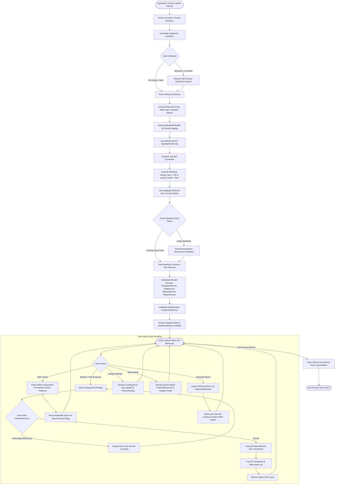

# Application Execution Flowchart (Runtime Architecture)
## Employee Management System with Maintainability Enhancement (Q11)

**Student:** Prabhat Singh Bhainsora (2410302046)  
**Course:** BBAT104 — Fundamentals of Total Quality Management  

---

## 1. Complete Application Lifecycle Flowchart

---

## 2. Key Architectural Guarantees

1. **Zero Data Loss on Crash:** With SQLite WAL mode and atomic commits, partial transactions roll back automatically.
2. **Deterministic Startup:** Even with deleted directories or corrupted config files, self-healing bootstrapping ensures the application always starts.
3. **No Thread Freezing:** Heavy PDF exports and chart rendering write directly to separate canvas structures without locking the application window.
