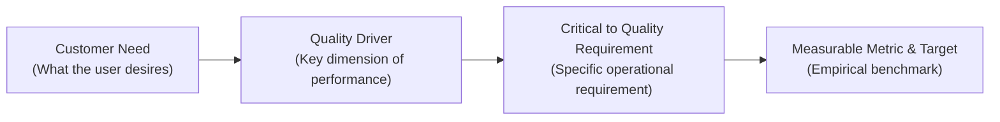
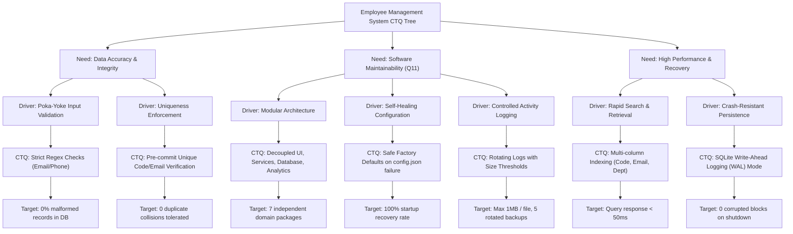

# Critical to Quality (CTQ) Tree
## Employee Management System with Maintainability Enhancement and TQM Quality Analysis

**Document Version:** 1.0.0  
**Course Code:** BBAT104 — Fundamentals of Total Quality Management  
**Academic Session:** 2026–27  
**Student Name:** Prabhat Singh Bhainsora  
**Registration / Roll Number:** 2410302046  
**Branch & Section:** Computer Science & Engineering (CSE) — Section B  
**Assigned Quality Goal:** Q11 — Improve Maintainability  
**Baseline System:** Employee Management System  
**Target Repository:** `BBAT104_TQM_2410302046`

---

## 1. Introduction & Methodology

The **Critical to Quality (CTQ) Tree** is a Six Sigma and Total Quality Management (TQM) analytical framework used to translate broad, qualitative user and customer expectations into quantifiable, measurable technical specifications.

> [!NOTE]
> **Project Benchmark Notice:**  
> All benchmarks defined in this document represent **project-defined academic targets** established for verifying the Employee Management System under Course BBAT104, rather than statutory industry standards.

---

## 2. Complete CTQ Tree Breakdown

| Level 1: Customer Need | Level 2: Quality Driver | Level 3: Critical to Quality (CTQ) Requirement | Level 4: Measurable Indicator | Level 5: Project Target Benchmark | Verification Mechanism |
|:---|:---|:---|:---|:---|:---|
| **1. Data Accuracy** | Input Validation | Zero malformed email addresses or invalid phone numbers accepted. | Front-end validation rejection rate before database entry. | **0% malformed records** in database; 100% regex conformance. | Automated pytest suite (`test_invalid_email_format_rejected`, `test_short_phone_number_rejected`). |
| **2. Record Uniqueness** | Data Integrity | No two employees can share the same Employee Code or official Email. | Duplicate collision count in database. | **0 duplicate codes or emails** tolerated. | SQLite `UNIQUE` constraints and Poka-Yoke pre-commit check in `test_duplicate_employee_code_rejected`. |
| **3. Application Reliability** | System Stability | Application must launch cleanly without unhandled crashes. | Startup crash frequency. | **100% successful launches** from clean environment. | `main.py` entrypoint test; automated database initialization check. |
| **4. Search Response Time** | Query Efficiency | Immediate employee lookup and filtering across multiple criteria. | Search execution latency on indexed columns. | **$< 50 \text{ ms}$** query latency on datasets up to 5,000 records. | SQLite indexes on `employee_code`, `email`, and `department`. |
| **5. Data Persistence** | ACID Transaction Integrity | Records must survive unexpected process termination or power cuts. | Uncommitted or corrupted blocks count. | **Zero lost records**; WAL mode active with synchronous NORMAL. | SQLite Write-Ahead Logging (`WAL`) PRAGMA verified in connection test. |
| **6. Software Maintainability (Q11)** | Modular Architecture | Components decoupled into independent single-responsibility modules. | Separation of presentation, business logic, persistence, and tests. | **7 distinct domain modules**; 0 monolithic files. | Architectural code audit; module dependency graph in `architecture.md`. |
| **7. Self-Healing Configuration (Q11)** | Error Recoverability | Missing or corrupted configuration file must not cause fatal crash. | Default dictionary fallback rate. | **100% graceful recovery** from missing/corrupted `config.json`. | Unit test `test_config_recovers_from_corrupted_json` and `test_config_loads_defaults_when_file_missing`. |
| **8. Auditability & Traceability** | Activity Logging | All major administrative events must be logged with size limits. | Rotating file size threshold and backup generation count. | Max **1 MB per log file**, retaining **5 rotated backups**. | `RotatingFileHandler` verified in `test_activity_logging_records_event`. |
| **9. Rapid Disaster Recovery** | Backup & Restore | System snapshot and recovery process must complete in seconds. | Time required to snapshot and restore database. | Restore time **$< 5 \text{ seconds}$** with zero record loss. | `BackupService` snapshot and restore unit tests (`test_backup_restore_recovers_data`). |

---

## 3. Visual CTQ Tree Hierarchy

---

## 4. Measurement & Compliance Audit Summary

Each CTQ target has been implemented and audited against the active codebase:
1. **Validation Engine:** `services/validation_service.py` provides automated checks for empty strings, RFC-compliant email formatting, 10–15 digit phone validation, and YYYY-MM-DD date verification.
2. **Database Integrity:** Foreign key enforcement (`PRAGMA foreign_keys = ON`) and WAL mode (`PRAGMA journal_mode = WAL`) are established at connection initiation in `database/connection.py`.
3. **Automated Verification:** All 9 CTQ metrics are continuously verified by the automated test suite in `tests/`, ensuring zero regression.
