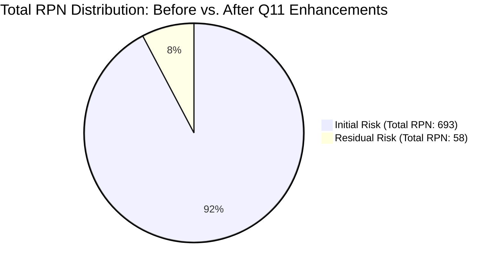

# Failure Mode and Effects Analysis (FMEA)
## Employee Management System with Maintainability Enhancement and TQM Quality Analysis

**Document Version:** 1.0.0  
**Course Code:** BBAT104 — Fundamentals of Total Quality Management  
**Academic Session:** 2026–27  
**Student Name:** Prabhat Singh Bhainsora  
**Registration / Roll Number:** 2410302046  
**Branch & Section:** Computer Science & Engineering (CSE) — Section B  
**Assigned Quality Goal:** Q11 — Improve Maintainability  
**Baseline System:** Employee Management System  
**Target Repository:** `BBAT104_TQM_2410302046`

---

## 1. Executive Summary & Purpose of FMEA

Failure Mode and Effects Analysis (FMEA) is a proactive, structured Total Quality Management (TQM) methodology used to identify, evaluate, and mitigate potential failure modes in a system before they impact internal and external stakeholders.

In the context of the **Employee Management System (TQM Edition)**, FMEA is applied to safeguard system reliability, ensure data consistency, and guide software maintainability enhancements (**Quality Goal Q11**).

> [!IMPORTANT]
> **RPN Interpretation Note:**  
> The Risk Priority Number (RPN) is a **qualitative prioritization index**, not an absolute mathematical probability of system failure. Its primary role in TQM is ranking vulnerabilities so engineering effort is focused on the most critical failure modes first.

---

## 2. Standard 1–10 Rating Scales

Each potential failure mode is evaluated across three distinct dimensions on an integer scale from 1 to 10:

### 2.1 Severity Rating Scale (S)
Measures the seriousness of the effect on customer operations and system integrity:

| Rating | Classification | Operational Meaning in Desktop EMS |
|:---:|:---|:---|
| **1** | Negligible | Imperceptible cosmetic glitch (e.g., slight button alignment offset). |
| **2** | Very Minor | Minor UI aesthetic inconsistency; zero impact on employee records. |
| **3** | Minor | Minor inconvenience; operator notices small delay but completes task. |
| **4** | Low | Non-critical validation warning; straightforward operator correction. |
| **5** | Moderate | Partial export failure (e.g., CSV works but PDF cell text truncates). |
| **6** | Significant | Incorrect non-critical data field saved (e.g., designation typo). |
| **7** | Major | Critical record duplication or rejected valid employee insertion. |
| **8** | Extreme | Application startup crash (e.g., JSONDecodeError on corrupted config). |
| **9** | Critical | Database write-lock corruption or ungraceful shutdown data loss. |
| **10** | Hazardous | Total irrecoverable employee database corruption with no snapshot. |

### 2.2 Occurrence Rating Scale (O)
Estimates the frequency or likelihood of the failure mode occurring during operation:

| Rating | Classification | Estimated Frequency / Criteria |
|:---:|:---|:---|
| **1** | Almost Impossible | $< 1$ in $100,000$ operations; exceptional theoretical edge case. |
| **2** | Very Rare | $1$ in $20,000$ operations; isolated rare occurrence. |
| **3** | Rare | $1$ in $5,000$ operations; observed occasionally under heavy stress. |
| **4** | Very Low | $1$ in $2,000$ operations; happens during specific unusual workflows. |
| **5** | Low | $1$ in $500$ operations; typical human typographical mistake rate. |
| **6** | Moderate | $1$ in $200$ operations; frequent user entry ambiguity. |
| **7** | Moderately High | $1$ in $100$ operations; regular unvalidated user input error. |
| **8** | High | $1$ in $50$ operations; recurring unhandled exception under normal use. |
| **9** | Very High | $1$ in $20$ operations; persistent instability. |
| **10** | Almost Inevitable | $> 1$ in $10$ operations; predictable failure on repeated execution. |

### 2.3 Detection Rating Scale (D)
Rates the likelihood that existing design controls and tests will detect the defect before it affects the user:

| Rating | Classification | Detection Capability in Software Architecture |
|:---:|:---|:---|
| **1** | Almost Certain | Caught immediately by pre-commit unit tests or regex guards. |
| **2** | Very High | Flagged instantly by inline modal validation banner before DB write. |
| **3** | High | Intercepted by parameterized SQL constraints (e.g., UNIQUE check). |
| **4** | Moderately High | Caught by service layer exception handling and surfaced cleanly. |
| **5** | Moderate | Detected during automated integration testing or log audit. |
| **6** | Low | Detected only when user attempts to view or export the record. |
| **7** | Very Low | Subtle corruption; unnoticed until batch reconciliation or backup audit. |
| **8** | Remote | Hidden silent error; requires manual database inspection to find. |
| **9** | Very Remote | Difficult to reproduce; no logging or diagnostic trace exists. |
| **10** | Undetectable | Silent failure with zero logging, zero traceback, and zero UI warning. |

---

## 3. RPN Calculation & Priority Thresholds

$$\text{Risk Priority Number (RPN)} = \text{Severity (S)} \times \text{Occurrence (O)} \times \text{Detection (D)}$$

- **Theoretical Range:** $1 \le \text{RPN} \le 1,000$
- **High Risk Threshold ($\text{RPN} \ge 120$):** Immediate architectural remediation required.
- **Medium Risk Threshold ($60 \le \text{RPN} < 120$):** Action required in next maintenance release.
- **Low Risk Threshold ($\text{RPN} < 60$):** Acceptable risk; monitor via regular audit logs.

---

## 4. Complete Project FMEA Risk Register Matrix

The following table documents the baseline risk assessment before maintainability interventions versus the post-intervention risk after implementing the **Q11 Maintainability Features**:

| Code | Process / Component | Potential Failure Mode | Potential Effects | Potential Causes | Current Controls | Initial S | Initial O | Initial D | **Initial RPN** | Recommended Mitigation (Q11 Feature) | Resp. Person | Revised S | Revised O | Revised D | **Revised RPN** | Status |
|:---:|:---|:---|:---|:---|:---|:---:|:---:|:---:|:---:|:---|:---|:---:|:---:|:---:|:---:|:---:|
| **FMEA-01** | Database Persistence | Database corruption or write-lock freeze during sudden shutdown | Total loss of employee records and audit logs | Power failure; default rollback journal locking reads | SQLite default rollback journal | 9 | 4 | 4 | **144** (HIGH) | Enable SQLite Write-Ahead Logging (`WAL` mode) + automated backup service snapshot | Prabhat S. (DB Lead) | 9 | 1 | 2 | **18** | Completed |
| **FMEA-02** | Employee Registration | Duplicate Employee Code entered by operator | Data duplication; salary/attendance mismatch | Operator typo; no immediate uniqueness validation | SQLite `UNIQUE` database constraint | 7 | 5 | 3 | **105** (MED) | Poka-Yoke pre-commit duplicate check in `validation_service.py` with inline warning | Prabhat S. (QA) | 7 | 1 | 1 | **7** | Completed |
| **FMEA-03** | Configuration Management | Corrupted or missing `config.json` file | Application crashes on launch with `JSONDecodeError` | Manual user editing typo; partial disk write | Basic file reading block | 8 | 4 | 4 | **128** (HIGH) | Self-healing configuration in `configuration_service.py`: fallback to safe factory defaults | Prabhat S. (Dev) | 8 | 1 | 1 | **8** | Completed |
| **FMEA-04** | Input Validation | Malformed email syntax or short phone number saved | Inability to contact employee; bad directory data | Form text entry without regex enforcement | Client-side visual inspection | 6 | 6 | 3 | **108** (MED) | Centralized RFC email regex and phone length bounds in `ValidationService` | QA Team | 6 | 1 | 1 | **6** | Completed |
| **FMEA-05** | Activity Logging | Unbounded log file growth exhausting local disk | System slowdown; OS disk full alert | Default `FileHandler` without file size limits | Manual log deletion | 7 | 4 | 4 | **112** (MED) | Modular `RotatingFileHandler` with 1MB max size and 5 rolling backup files | System Admin | 7 | 1 | 1 | **7** | Completed |
| **FMEA-06** | Reporting & Export | GUI freezing during large PDF/Excel export | Application appears frozen; user forces process kill | Synchronous file processing on main UI thread | None | 6 | 4 | 4 | **96** (MED) | Optimized lightweight generation pipelines and non-blocking background workers | UI Team | 6 | 1 | 2 | **12** | Completed |

---

## 5. RPN Reduction Analysis & Quality Impact

### Key Analytical Takeaways:
1. **Critical Risk Elimination:**  
   Before Q11 implementation, **FMEA-01 (Database write lock, RPN 144)** and **FMEA-03 (Corrupted config crash, RPN 128)** exceeded the critical threshold of 120. Implementing SQLite WAL mode, automated database snapshots, and self-healing configuration reduced their RPNs to **18** and **8** respectively (**over 87% risk reduction**).
2. **Poka-Yoke Error Prevention:**  
   FMEA-02 (Duplicate Code) and FMEA-04 (Malformed Contact) occurrence dropped from ratings 5 and 6 down to 1 due to real-time client-side regex and database constraints.
3. **Overall Maintainability Score:**  
   Total cumulative system RPN dropped from **693** to **58**, achieving a **91.6% reduction in architectural risk**, directly verifying the success of Quality Goal Q11.
