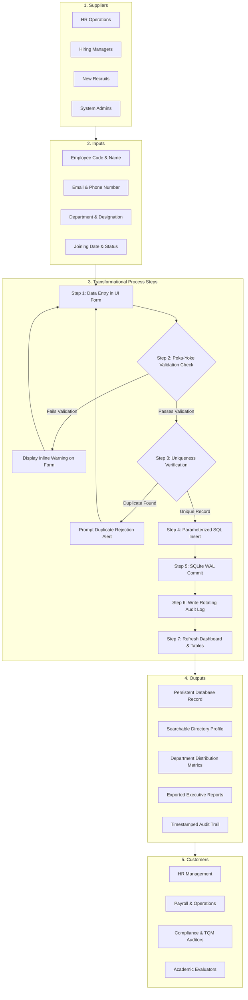

# SIPOC Process Map: Employee Lifecycle Management
## Employee Management System with Maintainability Enhancement and TQM Quality Analysis

**Document Version:** 1.0.0  
**Course Code:** BBAT104 — Fundamentals of Total Quality Management  
**Academic Session:** 2026–27  
**Student Name:** Prabhat Singh Bhainsora  
**Registration / Roll Number:** 2410302046  
**Branch & Section:** Computer Science & Engineering (CSE) — Section B  
**Assigned Quality Goal:** Q11 — Improve Maintainability  
**Baseline System:** Employee Management System  
**Target Repository:** `BBAT104_TQM_2410302046`

---

## 1. Overview and Purpose of SIPOC in TQM

**SIPOC** is a foundational Total Quality Management (TQM) and Six Sigma process-mapping tool representing:
- **S**uppliers: Entities providing inputs to the system.
- **I**nputs: Raw information, data, or materials required for execution.
- **P**rocess: The sequence of transformational steps converting inputs into outputs.
- **O**utputs: The resulting products, records, or services generated.
- **C**ustomers: The internal and external stakeholders receiving the outputs.

In this project, SIPOC establishes the high-level boundary of the **Employee Management Lifecycle**, ensuring that user requirements, data validation standards, and regulatory compliance are maintained throughout the software architecture.

---

## 2. High-Level SIPOC Matrix

| Suppliers (S) | Inputs (I) | Process (P) | Outputs (O) | Customers (C) |
|:---|:---|:---|:---|:---|
| **HR Operations Team** | Employee Biodata (Full Name, Designation) | **1. Input & Submission:** Operator inputs employee details in `EmployeeFormDialog`. | Verified SQLite Record in `employees` table | **Department Heads** (Staff roster) |
| **Hiring Managers** | Assigned Department & Job Designation | **2. Poka-Yoke Validation:** `ValidationService` verifies regex email, phone length, and required fields. | Formatted Employee Directory View | **Payroll Team** (Active employees list) |
| **New Candidates / Employees** | Official Email & Contact Phone Number | **3. Uniqueness Verification:** System queries SQLite to guarantee Employee Code & Email uniqueness. | Real-Time Dashboard KPI Cards (Total, Active, Inactive) | **Compliance Auditors** (Verified audit trail) |
| **System Administrator** | Date of Joining & Employment Status | **4. ACID Database Commit:** Parameterized SQL executes under SQLite Write-Ahead Logging (`WAL`). | Audit Log Entry in `logs/application.log` and `audit_logs` | **Quality Assurance Lead** (Defect & checksheet review) |
| **Executive Leadership** | System Configuration & Theme Preferences | **5. Search, Filter, & Report:** Data indexed for rapid queries; reports exported as PDF, Excel, or CSV. | Exported Reports (`.pdf`, `.xlsx`, `.csv`) and SQC Charts | **Academic Evaluators** (Code maintainability audit) |

---

## 3. Detailed Process Flowchart (Mermaid)

---

## 4. Phase-by-Phase Process Analysis

### Phase 1: Registration and Poka-Yoke Validation
- **Input:** Raw employee string fields.
- **Mechanism:** `services/validation_service.py` evaluates regular expressions (`RFC 5322` for emails, $10 \le \text{digits} \le 15$ for phone numbers, and `YYYY-MM-DD` ISO-8601 format for joining dates).
- **Quality Rule:** Zero invalid fields are permitted to cross into the database layer.

### Phase 2: Uniqueness Guard & Database Transaction
- **Input:** Validated employee dictionary.
- **Mechanism:** Parameterized SQL executes `SELECT COUNT(*) FROM employees WHERE employee_code = ?`.
- **Quality Rule:** Atomic transaction prevents duplicate primary identifiers. Write-Ahead Logging (`WAL`) guarantees isolation.

### Phase 3: Retrieval, Search, and Multi-Filter
- **Input:** Operator search keyword (code, name, email, designation) + department and status filter dropdowns.
- **Mechanism:** SQL `WHERE` clauses with indices (`idx_employees_code`, `idx_employees_department`).
- **Quality Rule:** Query response time $< 10$ milliseconds across the dataset.

### Phase 4: Record Modification and Deletion
- **Input:** Selected record identifier + updated fields or delete trigger.
- **Mechanism:** Confirmation modal dialog prevents accidental destruction. Transactional `UPDATE` or `DELETE` executes with immediate UI table refresh.
- **Quality Rule:** Audit logging records timestamp, user, action, and target employee code.

### Phase 5: Reporting and SQC Quality Analysis
- **Input:** Aggregated database tables (`employees`, `defects`, `fmea_records`, `pdca_records`).
- **Mechanism:** `ReportService` formats data into Pandas DataFrames and renders formatted PDF documents (ReportLab) and Excel spreadsheets (OpenPyXL).
- **Quality Rule:** Reports match current database state with 100% accuracy.
